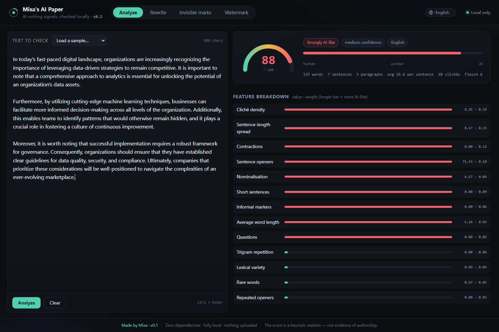

# Usage tutorial

A step-by-step walkthrough of **Misa's AI Paper Processing Project**. Ten minutes from
clone to first result.

- [0. Install](#0-install)
- [1. Score a piece of text](#1-score-a-piece-of-text)
- [2. Read the result](#2-read-the-result)
- [3. Rewrite it](#3-rewrite-it)
- [4. Check for invisible marks](#4-check-for-invisible-marks)
- [5. Inspect a file](#5-inspect-a-file)
- [6. Understand the watermark demo](#6-understand-the-watermark-demo)
- [7. Calibrate on your own corpus](#7-calibrate-on-your-own-corpus)
- [8. Use it from Python](#8-use-it-from-python)
- [9. Troubleshooting](#9-troubleshooting)

---

## 0. Install

Requirements: **Python 3.10 or newer**. No packages to install, no model to download.

```bash
git clone https://github.com/USER/misa-ai-paper.git
cd misa-ai-paper
python -m misa demo          # sanity check: runs every feature once
```

Windows users can skip the terminal: double-click **`start.bat`**. If it does not
start, double-click **`doctor.bat`** — it checks the folder, Python, the import, port
8765 and the key files, then tells you what is wrong.

Then start the interface:

```bash
python -m misa serve --open
```

It prints `running at http://127.0.0.1:8765` and opens the browser. Nothing leaves
your machine.

> The UI is English by default. Switch with the picker in the top-right corner, or add
> `?lang=zh-CN`, `?lang=zh-TW`, `?lang=ja` to the URL. The choice is remembered.

---

## 1. Score a piece of text

**In the browser** — open the *Analyze* tab, paste the text, press **Analyze**
(or `Ctrl+Enter`). To see what the tool does with real examples, pick one from
**Load a sample…**.

**From the command line:**

```bash
python -m misa analyze draft.txt
```

`draft.txt` can be replaced by:

* a path to any text file,
* `-` to read stdin (`cat draft.txt | python -m misa analyze -`),
* or a literal string (`python -m misa analyze "some text"`).

Add `--json` for machine-readable output, or `--fail-above 60` to make the command
exit with code 3 when the score exceeds a threshold (useful in CI).

---

## 2. Read the result



| Element | What it means |
| --- | --- |
| **Score 0–100** | Similarity to the default AI writing style — not a probability of authorship |
| **Band** | Looks human / Leaning human / Mixed / Leaning AI / Strongly AI-like |
| **Confidence** | How much text the score is based on; short inputs are pulled toward 50 |
| **Feature breakdown** | Each signal with its raw value, human/AI anchors and weight; longer bar = more AI-like |
| **Findings** | The specific phrases and patterns that pushed the score up |
| **Most AI-like sentences** | Per-sentence scores and reasons; clicking one selects it in the editor |

Three things to keep in mind:

1. **The score describes a register, not an author.** A legal memo and a template
   marketing page will both score high even if a human wrote them.
2. **Short text is noisy.** Under ~90 words the confidence label drops and the score is
   pulled toward 50 on purpose.
3. **Chinese and English use different feature sets** (6 vs 13), so compare scores
   within one language, not across.

---

## 3. Rewrite it

Open the *Rewrite* tab (the editor is pre-filled with the analyzer text if you loaded a
sample), choose a strength and press **Rewrite & compare**.

| Strength | What runs |
| --- | --- |
| Light | cliché replacement + skeleton flattening only |
| Standard | + contractions, discourse-opener trimming, long-sentence splitting |
| Strong | + rhythm breaking (splits one of three consecutive equal-length sentences) |

The result shows the before/after score, a **content-retention** figure, and one chip
per kind of change. If the score did not drop, the tool says so instead of pretending:
that usually means the problem is structure (too-uniform paragraphs) or the register
itself, not the vocabulary.

CLI equivalent:

```bash
python -m misa humanize draft.txt --level standard -o rewritten.txt --diff
python -m misa humanize draft.txt --text-only > rewritten.txt
```

> Rewriting changes wording only. It does not add facts, examples or opinions — those
> are what actually makes prose feel human.

---

## 4. Check for invisible marks

Open the *Invisible marks* tab, paste text copied from a web page, a PDF or Word, and
press **Scan invisible characters**.

The tool groups what it finds into: zero-width characters, tag characters (invisible
ASCII), variation selectors, bidirectional controls, unusual spaces and mixed-script
homoglyphs. Runs of eight or more invisible characters are reported separately as a
suspected payload.

**Clean & copy** removes them and puts the cleaned text on the clipboard.

```bash
python -m misa clean messy.txt -o clean.txt          # default: zero-width + tags + bidi
python -m misa clean messy.txt --mode all            # also variation selectors
```

> Character-level marks are removable. **Statistical watermarks are not** — see step 6.

---

## 5. Inspect a file

Drag a PNG, JPEG, PDF, DOCX, XLSX or PPTX onto the file panel, or:

```bash
python -m misa scan screenshot.png report.docx
```

You get:

* every metadata field that can identify the producing tool (PNG `tEXt`, JPEG
  EXIF/XMP, Office `docProps`, PDF `/Producer`);
* an **C2PA / JUMBF** badge when a signed content credential is present;
* AI-generation markers such as `trainedAlgorithmicMedia`, SynthID, DALL·E, Midjourney;
* for text files, the invisible-character report as well.

To remove the identifying metadata (pixels and body text are untouched):

```bash
python -m misa strip screenshot.png          # writes screenshot.clean.png
python -m misa strip contract.docx           # rewrites docProps/core.xml and app.xml
```

`--drop-exif` additionally removes EXIF — note that this loses camera data **and
orientation**, so the image may appear rotated afterwards.

> PDFs are read-only here: rewriting a PDF means rebuilding its cross-reference table.
> Use `qpdf` or `ExifTool`.

---

## 6. Understand the watermark demo

Open the *Watermark* tab and press **Run the demo** (or `python -m misa watermark --key my-key`).

The tool samples two passages with a toy bigram model — one plain, one watermarked with
a green-list scheme — then checks each with the right key and with six wrong keys.

```
1. No watermark    green 29/120 = 24%   z ≈ 0     p ≈ 0.6     not detected
2. Watermarked     green 78/120 = 65%   z ≈ 15    p < 1e-6    detected
3. Six wrong keys  z between −3 and +3             none detected
```

Read it as an explanation of the mechanism, not as a remover:

* The watermark is not a string hidden in the text; it is a bias in which tokens were
  sampled. You cannot find it, only test for it.
* Verification needs the key. Google's production keys are secret, so third parties
  cannot verify SynthID-Text output either.
* Green-list detection is one-sided: only a *surplus* of green tokens counts. The six
  wrong keys show what chance looks like — occasionally |z| ≈ 3, which is why a single
  run needs a p-value.

If you have your own key (for example a private deployment of the
[official SynthID-Text implementation](https://github.com/google-deepmind/synthid-text)),
you can check your own output:

```bash
python -m misa watermark --key <your-key> --detect output.txt
```

---

## 7. Calibrate on your own corpus

The built-in anchors were tuned on eight samples. If you have labelled text, re-fit
them — this is the single biggest accuracy improvement available.

```bash
mkdir -p my-corpus/human my-corpus/ai
# put 15+ .txt files in each; keep genre and length similar between the two sets

python -m misa calibrate my-corpus --write calib.json
python -m misa analyze draft.txt --calibration calib.json
```

The output lists each feature's human mean, AI mean, separation and new weight. If the
two groups are too similar on a feature, its weight drops to near zero automatically.

---

## 8. Use it from Python

```python
from misa import analyze, humanize, scan_invisible

result = analyze(open("draft.txt", encoding="utf-8").read(), locale="en")
print(result.score, result.to_dict()["band"])

rewritten = humanize(result.text, level="standard")
print(rewritten.before.score, "->", rewritten.after.score)
print(rewritten.text)

report = scan_invisible(rewritten.text, locale="en")
print(report["total"], report["verdict"])
```

Lower-level modules are importable too: `misa.analysis.calibration`,
`misa.watermark.metadata`, `misa.watermark.greenlist`, `misa.i18n`.

---

## 9. Troubleshooting

| Symptom | Cause | Fix |
| --- | --- | --- |
| `'·' is not recognized as an internal or external command` | an old `start.bat` containing non-ASCII text | re-download the repo; the current script is pure ASCII |
| `[ERROR] Python 3.10+ was not found` | Python missing from PATH | install Python 3.10+ and tick “Add python.exe to PATH” |
| `[ERROR] Cannot import the misa package` | wrong working directory | `cd` into the project folder first |
| `cannot listen on 127.0.0.1:8765` | port already in use | `python -m misa serve --port 8766` |
| `No module named 'tracelens'` | the project was renamed | the package is now `misa`: `python -m misa ...` |
| Score looks wrong for a short text | fewer than ~90 words | paste more text; confidence is reported honestly |

Still stuck? Run `doctor.bat` (Windows) and include its output in the issue.
